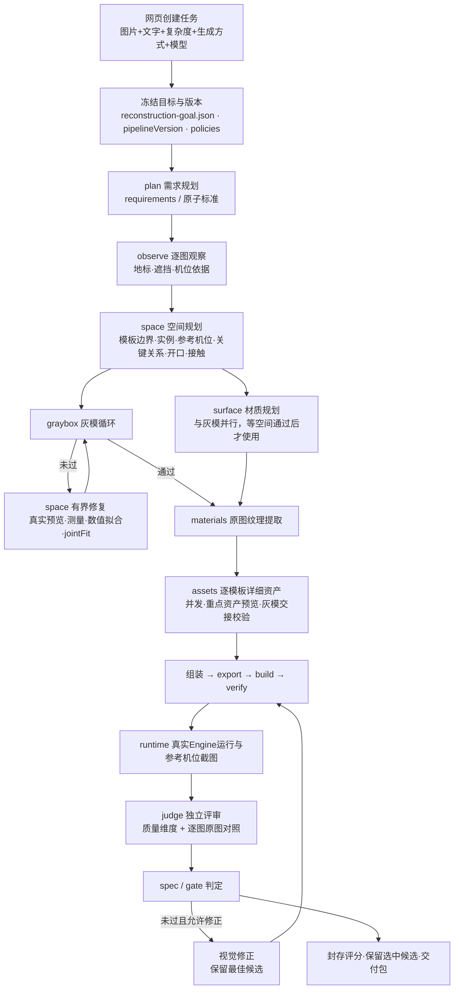
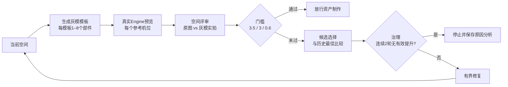

# 普通图片转场景管线：流程与质量保证

本文是普通场景（非体素）管线的总览，回答两个问题：

1. 一张或几张图片，经过哪些步骤变成可运行的三维场景。
2. 管线用哪些机制保证产出符合要求，哪些部分还没有被证明。

代码基线为 main 的 `c687070`（2026-10-12）。灰模修复阶段最近几轮改造的原因和效果，见 [灰模修复改造说明](graybox-repair-improvements-2026-10-12.md)。原图对照的判定规则见 [原图目标与验收依据](image-reconstruction-goal.md)。体素分支见 [体素运行说明](voxel-scenes.md)。

## 一、“符合要求”的定义

| 层级 | 判定 | 门槛 | 作用 |
|---|---|---|---|
| 灰模（空间） | composition-v3 空间评审 | 空间分 ≥3.5/5、每条关键关系 ≥3/5、置信度 ≥0.6，关键主体或主通路不能 missing；多机位联合拟合（jointFit）不能退步 | **资产制作的前置闸门**。不过就不放行详细资产，避免在错误的空间上堆细节 |
| 成品（基础交付） | basic70 | 综合分与原始维度加权分都 ≥70；运行硬检查、结构检查都通过；没有关键缺失和已确认的规范缺陷；资产齐全，置信度达标 | 可运行、主体正确的场景 |
| 成品（严格） | strict / scene-quality-v4.1 | 综合分 ≥80，各维度 ≥3，置信度 ≥0.65 | 更高的质量档 |
| 原图还原 | `referenceMatch` 逐图对照 | 每张原图的六类属性（主体结构、布局遮挡、轮廓构造、材质色彩、光照、机位构图）都“接近”或“大体一致” | 是否“像原图”。与上面两档分开报告，互不替代 |

**unverified（未核实）永远不算通过。** 对照缺失、证据不足、漏图、错机位、摘要无效，都按未核实处理。

## 二、流程总览

服务端入口在 `workbench/src/runner.ts` 的 `createJob` 和 `run` 中，普通场景主流程在 `geometry/run.ts` 的 `runGeneralScene` 中。

## 三、各阶段做什么、怎么把关

每一次模型调用都经过 `callValidated`：先用 JSON Schema 约束输出，再由程序校验器检查。不合格就带着全部错误进行有界纠正，纠正失败则阶段失败，不会把不合格的输出传给下一步。

| # | 阶段（`job.stage`） | 模型角色 | 产出 | 程序把关 |
|---|---|---|---|---|
| 0 | input（创建） | — | `job.json`、`reconstruction-goal.json` | 冻结原图顺序和 SHA、用户文字修改、版本快照、模型配置和各项策略。验证控制文件（如果配置了）会锁定可用的模型、输入集和生成方式，不匹配时禁止创建 |
| 1 | plan | `plan` | 需求列表（带 critical 标记和权重）、原子验收标准 | 例如：精确数量只能来自用户的明确文字，从图像推断的数量必须为 null；需求 id 必须唯一 |
| 2 | observe | `scene-observation` | `reference-observations.json`：每张图的地标框、遮挡、可见范围、机位依据 | 地标必须绑定具体图片和框，不能凭空增加 |
| 3 | space | `scene-space` | 空间规划：模板及其边界、实例位姿、每张参考图一个参考机位、空间关系（critical）、开口、接触 | 空间合法性（边界、重叠、支撑）；观测绑定；每个关键地标在每个机位上至少有一个独占实例（critical-view-exclusive-v1）；必须声明开口和接触；预算预留检查 |
| 4 | surface | `scene-surface` | 逐实例的表面与材质规划 | 与灰模并行以节省时间，但只有空间最终通过、且与通过的空间一致时才会使用 |
| 5 | graybox 循环 | `scene-blockout` + `scene-space-judge` | 每轮的灰模场景、参考机位的真实 Engine 截图、空间评审、`gate.json` | 见第四节 |
| 6 | materials | —（程序） | 从原图提取的纹理及来源 | 纹理来源绑定原图像素区域 |
| 7 | assets | `geometry-asset`（每个模板一次） | 各模板的详细几何 | 默认最多 6 个并发；按重点程度排序，最多 3 个重点资产做独立预览；每个资产都要通过与已通过灰模的交接校验（`assertProceduralHandoff`）；局部几何的依据必须与通过的灰模一致 |
| 8 | 组装、export、build、verify | — | Engine 项目和构建产物 | 资产总量预算、结构检查、构建校验 |
| 9 | runtime | — | `runtime/runtime.json` 和截图 | 在真实 Engine 中运行，按参考机位截图；运行证据必须与产物摘要一致 |
| 10 | judge | `judge` | 质量维度评分、规范项、逐图 `referenceMatch` | 每一条判断都必须引用真实截图文件名；原图对照绑定原图 SHA、截图 SHA 和构建摘要 |
| 11 | spec / gate | — | `quality.json`、`spec-report.json`、`image-reconstruction.json` | 按第一节的门槛判定 |
| 12 | repair（视觉修正） | `scene-repair-plan` 等 | 新一轮候选 | 每轮都要重新渲染、重新评审；总是保留最佳候选 |
| 13 | 交付 | — | 封存的评分、选中候选、原图对照、下载包 | 预览、判定和下载指向同一份产物 |

## 四、灰模循环：质量保证的核心

空间错了，后面的资产再精细也救不回来；资产制作也只能做局部修改，补救不了整体构图。所以管线把空间质量放在资产之前，并为它设计了专门的修复循环（`geometry/blockout.ts` 中的 `acceptSpatialLayout`）。

**1. 评审只看真实画面。** 评审拿到的是原图和同一参考机位下的 Engine 实拍灰模。每条关系都必须给出分数、判定（met / partial / missing / uncertain）、理由，并引用真实的帧文件。灰模无法证明的属性（反射、颜色、光照）标为 uncertain、记 3 分，留到成品阶段验证，不会冒充已通过。

**2. 修复阶段有可测量的目标。** 修复模型可以使用以下工具：

- `preview_graybox_space`：真实渲染候选补丁。
- `measure_graybox_space`：零 Engine 的几何测量，给出各目标的边缘残差。
- `fit_graybox_space`：有界数值拟合，只用来产生预测。

测量用 reference composition v5 把每个关键地标对应到具体实例或部件，所以修复是在降低可测量的残差，而不是凭感觉改。

**3. 修复的范围有边界。** 修复只能做以下几类改动：

- 改位姿、机位、局部部件和接触关系。
- 最多扩大 2 个模板的边界，只增不减，每轴跨度不超过原来的 2 倍。

修复不能增删实体，也不能改需求或原图目标。所有改动都要重新通过空间、开口和接触校验。

**4. 跨机位不能顾此失彼（jointFit）。** 出现以下任一情况，候选就不能被选中：

- 某个参考机位的平均残差变差。
- 某个关键目标变差，或者变得不可见。
- 已测的关键覆盖范围缩小。

在 joint-fit-net-v1 下有一个例外：某机位整体改善至少 0.01 时，允许其中一行变差不超过 0.03。

**5. 选择规则只接受真实的进步。** 每一轮都与历史最佳比较：

- **新增了关键阻断：** 默认丢弃这一轮。例外是同时满足以下全部条件时（net-closure-v1/v2）：
  - 关掉的阻断多于或等于新开的；
  - 新开的阻断都在关键阈值 0.5 分以内；
  - 空间分提高。
- **没有新增关键阻断：** 按空间分比较。

被拒绝的候选会记为“需要诊断”，不会成为下一轮的基础。

**6. 治理：有界、诚实的停止。** 有效提升的门槛是至少 0.1 分。连续 2 轮没有有效提升就停止（`noGain:2`），并保存原因分析与优化方案（`quality-diagnoses/`），不会无限消耗调用。只有“生成到验收通过”（qualified）模式会取消总轮数和总调用数的上限，但无提升停止的规则仍然有效。

## 五、其他保证机制

| 机制 | 实现位置 | 保证什么 |
|---|---|---|
| 目标冻结 | `reconstruction-goal.json`、`image-reconstruction.ts` | 后续阶段不能用模型自己的概括、派生图片或自行扩展的内容替换原图目标 |
| 版本与策略冻结 | `versions.ts`、`createJob` 写入的 `pipelineVersion`、`profile`、`*Policy` | 同一任务全程使用同一套代码和规则；新规则只作用于新任务，历史任务按原规则重放 |
| 证据绑定 | `sealSpatialAssessment`、`sealAssessment`、`output-delivery.ts` | 截图、评分、候选和下载包互相绑定摘要，旧报告或别的候选的报告不能冒充当前结果 |
| 阶段复用 | `stage-contract.ts`（schema + 依赖源码指纹） | 只有契约完全相同的已验证输出才会被复用，代码一变复用就失效 |
| 模型调用恢复 | `provider-recovery.ts`（最多 3 次尝试、2 次超时、1 小时）、执行恢复与检查点 | 网络或模型服务短暂故障时自动重试；仍失败则阻塞任务并保留全部尝试，可在网页上点击“手动恢复生成”从原阶段继续，不重复消耗已完成的阶段 |
| 预算 | 模型账本、`freshSceneReservation`、`hasSceneBudget` | 开始前预留规划、生成、评分和恢复所需的调用；余量不足时不启动；资产不齐时交付明确标为草稿的部分产物，而不是假装完成 |
| 最佳候选保留 | `boundedIterations`、`restoreIteration` | 修正轮次变差或中断时，交付的仍是已验收的最佳候选及其报告 |
| 交付三问分开显示 | 详情页 | 有没有可运行的输出、是否达到基础交付、是否与原图一致，三者分开展示，不能互相替代 |

## 六、生成方式

| 方式 | 视觉修正轮数 | 适用场景 |
|---|---|---|
| first-pass（仅首轮验证） | 0 | 测一次生成的真实水平 |
| bounded（自动修正，默认） | 最多 2 轮 | 日常生成 |
| qualified（生成到验收通过） | 不限，但连续 2 轮无有效提升即停止 | 追求合格率；E2E 验证使用这一档 |

## 七、怎样确认“稳定产出”

单次成功不代表稳定。目前的验证方法如下：

1. **只算网页用户路径。** 用网页创建任务并运行，API 调用或文件回放只算诊断。
2. **隔离运行。** 每轮使用独立的 DATA 目录、模型账本和验证控制文件（控制文件中的 `model` 必须与任务的模型一致），历史目录只读。
3. **使用固定的代表性输入。** 目前是游乐场、地铁、市场三个场景，一次跑 3 个。
4. **失败时先看产物再改机制。** 依次看各轮的 `gate.json`（`selection.reason`）、`space-repair-N/` 中的契约错误、预览审计和治理记录，找到瓶颈后再改机制。重跑要有新的条件或新的机制，不能原样重试。
5. **发布级认证另有门禁。** 代码中的稳定版本门禁要求：三种复杂度、每种输入模式至少 30 例、成功率 0.9、总体 95% Wilson 下界 0.8，并完成独立评审标定。目前还没有做这一级认证。

### 当前状态（2026-10-12）

| 场景 | 灰模通过 |
|---|---|
| 游乐场 | 2/2（3.6、3.5） |
| 地铁 | 2/2（3.7、3.5） |
| 市场 | 1/3（3.6 通过；另两次在 3.0 和 3.2 停止） |

市场最近一次失败的原因已经通过 c687070（net-closure-v2）修复，但 r9、r10 两次验证都因为模型服务不可用而中断，**这项修复还没有经过真实生成验证**。

## 八、尚未保证的部分

- **灰模合格不等于成品合格。** 以上统计只到灰模闸门。之后的资产、成品 basic70 和原图对照还没有在这批场景上做稳定性统计。
- **原图还原是独立目标。** 历史上完整成品已经达到 basic70，但原图对照都没有通过，管线目前不能声称“稳定复刻原图”。
- **评分来自模型。** 空间评审和最终评审都是模型基于真实画面给出的判断，没有做独立标定；残差测量只比较矩形边缘，不是像素分割。
- **结构过于简单的地标提分有限。** 比如市场的远端只有一块平板，单靠位置拟合提升有限，可能需要在规划阶段给出更丰富的模板。
- **模型服务可用性是外部依赖。** 网络或中转服务不可用时，管线只能阻塞并保留进度，无法自行完成。
